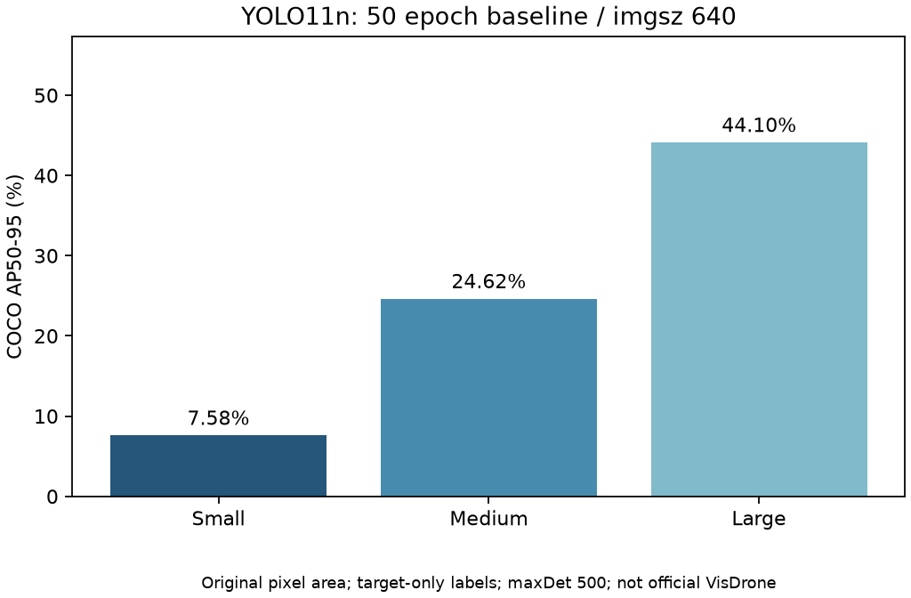
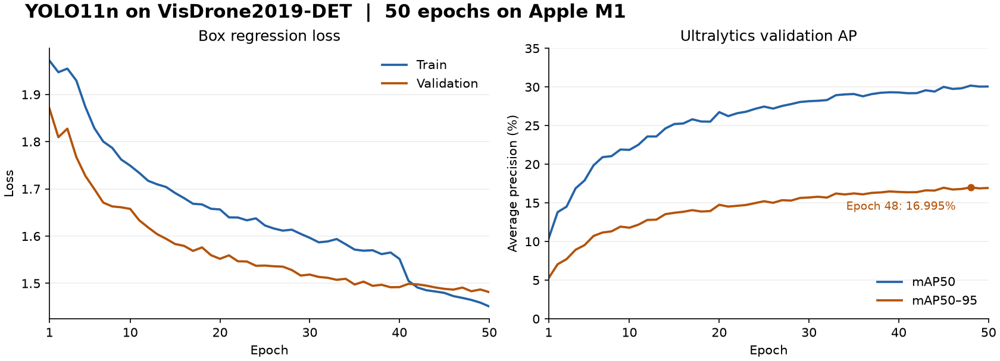

# exp-003 — YOLO11n 50-epoch MPS baseline

**Status: completed.** 전체 학습·검증 분할에서 50 epochs와 최종 평가를 완료했습니다. [측정 요약](summary.json)에 평가 조건, 입력 및 출력 파일의 hash, 실행 코드 버전을 기록했습니다.

## Hypothesis and fixed conditions

YOLO11n을 전체 VisDrone train/val로 50 epochs fine-tuning하여 입력 해상도·tiling·augmentation 비교의 기준을 확보합니다. 본학습 종료는 수렴의 자동 증명이 아니며 loss/val curve와 best epoch를 함께 검토합니다.

- [설정](../../configs/yolo-baseline-mps.toml): imgsz 640, batch 8, MPS FP32, seed 42, 50 epochs
- 동일 COCO-pretrained YOLO11n·weights hash, 동일 변환 v2·dataset manifest hash
- Train 6,471 / val 548장; SGD lr0 0.01, momentum 0.937, weight_decay 0.0005, mosaic 1.0
- 마지막 10 epochs에서 mosaic 종료. effective warm-up은 설치된 framework의 3 epochs이며 1-epoch pilot의 effective warm-up 0과 다름
- evaluator/confidence/NMS/maxDet/area/timing은 [pilot](../exp-002-yolo11n-pilot-mps/README.md)과 동일. epoch 수·LR schedule·mosaic 종료 정책이 달라 pure epoch-only ablation으로 해석하지 않음
- 공식 VisDrone ignore masking 미적용, train 중복 label 처리와 MPS 결정성 한계 유지

## Execution

2026-10-09 01:59–11:56 (Asia/Seoul)에 Apple M1의 MPS에서 실행했습니다. Python 3.11.9, macOS 14.7.8, Ultralytics 8.4.174, PyTorch 2.14.1, pycocotools 2.0.11을 사용했습니다. 실행 commit은 `6a517db0e4cf07e2c36f579de985dcf394d12c98`이며 당시 작업 트리에 변경 사항이 없었습니다.

당시 실행 명령과 상태 조회 명령은 다음과 같습니다. 재실행은 기존 결과를 보존할 수 있도록 새 experiment ID를 사용합니다.

```bash
.venv-yolo/bin/python -B scripts/start_yolo_job.py --config configs/yolo-baseline-mps.toml --export
.venv-yolo/bin/python -B scripts/start_yolo_job.py --status exp-003-yolo11n-baseline-mps
```

별도 로컬 process가 학습 → 최종 validation → 전체 prediction/COCO 평가 → 고정 P/R·timing을 수행합니다. `console.log`, job 상태, config snapshot을 ignored `outputs/.jobs/<id>/`에 보존하며 epoch 완료 후 `progress.json`을 atomic하게 갱신합니다. 50/50 epochs에 도달해도 후속 평가가 끝나기 전에는 completed로 표시하지 않습니다. 실제 종료 epoch가 요청한 50과 다르면 runner는 실패로 기록합니다.

성공 후 checkout branch·HEAD가 동일하고 사용자 변경사항이 없으면 검토용 summary/CSV/AP plot만 working directory에 생성합니다. 기존 README는 유지합니다. checkout이 바뀌면 결과는 로컬에 남기고 `completed_awaiting_export`로 기록합니다. worker는 commit/push/merge를 수행하지 않습니다. 결과 검토 후 별도 commit·push·PR review로 마무리합니다.

Mac에서는 job 수명 동안 `caffeinate -i -s`로 idle sleep을 방지합니다. 실행 종료 시 자동 해제되며 영구적인 OS 설정 변경은 없습니다. 장시간 학습 중에는 전원을 연결하고 덮개를 열어 둡니다. 재부팅·강제 종료·덮개 닫기로 중단되면 자동 재시작하지 않으며 checkpoint와 실패 로그를 보존합니다. 현재 runner의 checkpoint resume은 미구현이므로 중단 시 재개 경로를 검토한 뒤 진행합니다.

## Pre-launch validation

- 합성 regression 79개 및 no-site metadata 테스트 17개 통과. 설정 dry-run, dependency check, 구조·로컬 링크·ignore·staged diff 검증 통과
- 별도 `validation-yolo-durable-mps-v2` job에서 실제 MPS 32/8장, 2 epochs 학습 → 최종 validation → prediction/COCO/P-R/timing까지 completed, exit code 0 확인. 실행 source commit은 `6106983cb48ab246c894ab9e17439d77f52675d8`; 이후 완료 상태 설명과 이 검증 기록만 보완
- 최초 probe는 framework의 최종 best-checkpoint validation callback을 추가 학습 epoch로 잘못 세어 진행 기록에서 실패. checkpoint·실패 로그를 보존했고, 최종 평가 callback을 구분하도록 수정한 뒤 v2에서 재검증
- 임시 폴더에서 실제 pilot 결과 export를 실행해 기존 experiment README 보존과 중복 summary/CSV/figure export 거부 확인. 설치된 source의 effective warm-up도 1 epoch = 0, 50 epochs = 3으로 확인
- probe는 실행 검증용 subset이다. 아래 본학습 결과는 전체 train/val을 사용한 별도 실행에서 얻었다.

## Measured results

AP는 원본 이미지 좌표에서 target-only COCO bbox 평가로 계산했습니다. IoU 0.50:0.05:0.95, maxDet 500 기준이며 공식 VisDrone ignore suppression은 적용하지 않았습니다. 작은 객체는 원본 bbox 면적이 0–1,024 px²인 구간입니다. P/R은 confidence ≥ 0.25, 같은 class·IoU ≥ 0.50의 일대일 대응으로 계산했습니다.

| Metric | 1-epoch pilot | 50-epoch baseline |
| --- | ---: | ---: |
| COCO mAP50 | 8.55% | 27.55% |
| COCO mAP50–95 | 4.58% | 15.84% |
| AP_small | 1.42% | 7.58% |
| AP_medium | 7.54% | 24.62% |
| AP_large | 15.14% | 44.10% |
| Precision | 54.21% | 62.76% |
| Recall | 21.40% | 42.55% |
| Small-object recall | 9.76% | 29.03% |

[결과 CSV](../../results/tables/exp-003-yolo11n-baseline-mps.csv)에서 AP와 P/R은 0–1 범위로 기록합니다. 작은 객체 재현율은 `(small_targets - missed_small) / small_targets`로 계산했습니다. 비교는 같은 평가 규칙을 사용했으며 학습률 일정, warm-up 및 마지막 학습 구간의 mosaic 적용 여부도 두 실험 사이에 달랐습니다.



MPS FP32, batch 1에서 검증 이미지 20장을 이미 디코딩한 BGR 배열로 입력했습니다. warm-up 3회 후 각 이미지의 전처리, 추론, NMS 및 결과 생성 시간을 측정하고 호출 전후에 MPS를 동기화했습니다. 평균 **14.35 ms**, 중앙값 **13.31 ms**, p95 **21.04 ms**, 측정 구간 기준 **69.67 FPS**였습니다. 디스크 읽기·디코딩은 제외했습니다. 같은 20장 표본에 대한 측정이므로 장시간 처리량을 확인하려면 별도 반복 측정이 필요합니다.

## Learning curves and checkpoint



[곡선 데이터](../../results/tables/exp-003-yolo11n-baseline-mps-learning-curves.csv)는 로컬 `outputs/exp-003-yolo11n-baseline-mps/train/results.csv`의 epoch별 수치에서 추출했습니다. Validation box loss는 1 epoch의 1.87025에서 50 epoch의 1.48140으로 낮아졌습니다. Ultralytics validation mAP50–95는 48 epoch에서 16.995%로 가장 높았고 50 epoch에서도 16.931%였습니다. 후반부는 이 실행에서 관찰된 변화이며, 추가 학습이나 반복 실험의 결과는 아직 측정하지 않았습니다.

최종 COCO 평가에 사용한 로컬 `train/weights/best.pt`의 SHA-256은 [summary.json](summary.json)의 `metrics.best_weights_sha256`과 일치합니다. 학습 곡선의 Ultralytics validation AP와 위 결과 표의 별도 COCO 평가 AP는 각각의 평가 경로에 해당합니다. 별도 최종 Ultralytics validation의 mAP50–95는 17.00%였습니다.

## Failure analysis

고정 판정 기준에서 TP 16,493개, FP 9,787개, FN 22,266개였습니다. 작은 객체 26,588개 중 누락은 pilot 23,992개에서 본학습 18,869개로 줄었습니다. 두 실험의 같은 검증 이미지 중 누락이 많은 사례를 비교했습니다.

| 검증 이미지 ID | 전체 객체 수 | 작은 객체 누락, pilot → baseline | 전체 FP, pilot → baseline |
| --- | ---: | ---: | ---: |
| 375 | 317 | 257 → 205 | 63 → 85 |
| 372 | 306 | 253 → 201 | 26 → 78 |
| 373 | 311 | 244 → 192 | 31 → 73 |

[예비 실험에서 확인한 동일 교차로의 유사 장면](../exp-002-yolo11n-pilot-mps/README.md#failure-analysis)입니다. 이 사례들에서는 누락이 줄면서 오검출이 늘었습니다. 표본은 누락이 많은 장면의 예시이며, 장면 특성이나 원인을 검증하려면 가림·밀집도별 분석과 이미지에 대한 별도 검토가 필요합니다.

로컬 기록에서 50개 epoch의 연속성, 작업의 정상 종료, 실행 commit과 소스 hash, 최종 checkpoint와 요약 파일의 hash를 대조했습니다. 이 결과를 이후 비교의 YOLO11n 기준으로 사용합니다. 다음 실험은 같은 검증 분할과 공통 평가 규칙을 사용하는 RT-DETR 기준 실험입니다.
